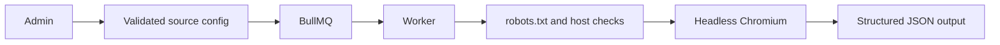

# Puppeteer Scraping Framework

[](https://github.com/yashybm30/puppeteer-scraping-framework/actions/workflows/ci.yml)

An independently runnable portfolio project demonstrating validated json source configuration and structured record extraction.

## Implemented behavior

- Validated JSON source configuration and structured record extraction
- Host allowlist, private-address checks and redirect/request interception
- robots.txt checks and a dedicated identifying user agent
- BullMQ bounded retries, retained failed jobs and hourly scheduling
- Local JSON results plus tenant-scoped job status API

## Architecture



## Requirements and setup

Node.js 24 and npm. Docker Engine with Compose v2 is needed for local databases/queues. Native browser scraping also requires Chromium. Exact dependencies and reproducible versions are in package.json/package-lock.json.

```bash
npm ci
npm run check
```

```bash
cp .env.example .env
# Edit the environment before starting; use random independent signing secrets.
docker compose --env-file .env up --build -d
```

Run one stack at a time because localhost development ports overlap. For native execution, run `npm run build`, start the documented dependencies, apply migrations where applicable, then `npm start`. Node reads `.env` for the start and SQL migration scripts; Vitest requires exported test environment variables. Bash examples use `NAME=value command`; PowerShell uses `$env:NAME='value'` before the command.

## Configuration

- `PORT`: HTTP port (default 3000).
- `JWT_SECRET`: at least 48 random characters; match the trusted issuer when using auth-service tokens.
- `JWT_ISSUER` / `JWT_AUDIENCE`: default `portfolio-auth` / `portfolio-api`.
- `CORS_ORIGIN`: comma-separated browser origins, deny cross-origin by default.
- `REDIS_URL`: local Redis connection where applicable.
- `SCRAPE_ALLOWED_HOSTS`: exact allowed hostnames.
- `PUPPETEER_EXECUTABLE_PATH`: optional preinstalled Chromium binary.
- `ALLOW_PRIVATE_TARGETS`, `ALLOW_NO_SANDBOX`: local-test exceptions only, default false.

## Usage and contracts

POST `/v1/scrapes` with the JSON in `sources/books.json`, then GET `/v1/scrapes/:id`. Admin POST `/v1/scrapes/schedules` creates/replaces a tenant/source-name hourly scheduler. The worker permits one active browser and at most one new job/second, retries three times with exponential backoff, and retains failures for seven days. JSON results are written to `results/<job-id>.json` and returned through the authorized job API.

Set `SCRAPE_ALLOWED_HOSTS` (default `books.toscrape.com`) to hosts you are authorized to scrape. Do not scrape sites that prohibit your use. A missing robots file (404) allows the configured URL; other robots fetch errors fail closed. Requests to disallowed or private destinations are blocked. `ALLOW_PRIVATE_TARGETS=true` exists only for disposable fixture testing, not internet-facing deployment.

Native `npm ci` downloads Puppeteer's browser. Alternatively set `PUPPETEER_SKIP_DOWNLOAD=true` during install and `PUPPETEER_EXECUTABLE_PATH` at runtime to a compatible Chromium binary. The Docker image installs Chromium. Sandbox restrictions differ by host: keep the browser sandbox enabled; `ALLOW_NO_SANDBOX=true` is an explicit escape hatch only for a separately isolated local test container, with no secrets or private-network access.

### Authentication and health

Authenticated HTTP examples use `Authorization: Bearer $ACCESS_TOKEN`. Obtain a correctly scoped token from your trusted issuer or the portfolio auth service using the same signing/issuer/audience settings. No production debug token endpoint is exposed. GET `/health/live` verifies the process; GET `/health/ready` checks the project's primary dependencies. `/docs` exposes route documentation; request examples here define the detailed contracts.

## Validation

```bash
npm run check
npm run test:integration  # requires actual local dependencies, where a suite exists
```

Unit tests never imply integration success. Integration suites use disposable namespaces and test signing keys; never point them at production. Tests import compiled application modules to preserve NestJS decorator metadata. See Actions for the current hosted status. External provider calls and cloud deployments are not part of local acceptance.

## Deployment and operations

The Dockerfile uses a separate build stage and a non-root runtime. Start dependencies and migrations before the application. Compose is a local development setup. For GCP/GKE or another cloud, publish a reviewed image, inject secrets using the platform secret manager, configure private dependency connectivity, health probes and resource limits, and verify graceful shutdown. No paid cloud resource is created by this repository.

## Security and trade-offs

Bearer identity is verified with an explicit JWT algorithm, issuer, audience and structured claims. Tenant IDs come from verified tokens, not headers. New services validate access-token expiry but do not introspect the authentication service for immediate token revocation; use short-lived tokens or add an introspection boundary where required. Limits and permission checks are documented per endpoint. Use TLS, workload credentials, restricted networks, backups, request quotas and least-privilege runtime roles before real deployment.

## Known limitations

robots.txt is checked for the initial page; redirected paths also need policy review. DNS rebinding and browser-network isolation require egress firewall enforcement for hostile multi-user deployment. No CAPTCHA bypass, authentication scraping, proxy rotation, or unlimited crawl is implemented. Scheduled jobs are operator-created and must be removed administratively when no longer needed.

## Roadmap

Expand failure-mode coverage, validate external integrations in a staging account, add deployment-specific telemetry and retention policy, and review action/dependency updates regularly. Features described above are implemented; this roadmap is not a completion claim.

MIT licensed. See CONTRIBUTING.md and SECURITY.md.

### Standalone development identities

For a disposable local setup without a separate identity server, set the same random `JWT_SECRET` as the API and run `npm run token:dev -- <subject-uuid> <tenant-uuid> <admin-or-member>`. The CLI prints a 15-minute token; it is disabled when `NODE_ENV=production`. Keep it in your shell session, never commit it or paste it into issues. This is a local development utility, not a public login endpoint. Production must use a trusted identity issuer.
